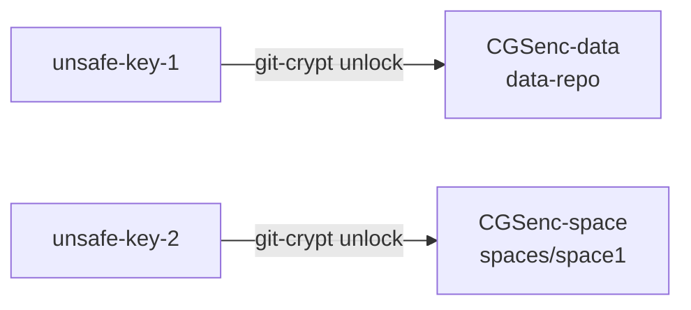

# .keys — unsafe git-crypt keys for the CGSenc test trees

*Created: 2026-11-21*

## Abstract

**What this is.** Two git-crypt keys made with `git-crypt keygen`, committed
in clear on the `data-encrypt` branch only. They are the prototype's
equivalent of a `--dry-run`: they let the EncryptedRepos work be shown
end to end without Bitwarden and without a real key (owner, 2026-11-21).

**Why they are unsafe.** Anyone who can read this branch can decrypt
everything they encrypt. They protect synthetic data only, never a real
figure, and are never reused anywhere else.

**Who it is for.** Whoever creates the CGSenc repositories (step 0 of the
ticket) and whoever runs the encrypted tests.

**What you need to do with it.** Use them only with the CGSenc repositories,
for prototyping. Never use them on real data: when the feature is used for
real, the owner makes real keys for that project, outside this repository.

---

| Key | Repository | Mounted at |
|---|---|---|
| `unsafe-key-1` | `github:flipoyo/CGSenc-data` | `data-repo` |
| `unsafe-key-2` | `github:flipoyo/CGSenc-space` | `spaces/space1` |

A repository takes its key at creation, before its first encrypted file is
committed, and a test tree is unlocked the same way:

    git-crypt unlock <path-to>/.keys/unsafe-key-1     # inside data-repo
    git-crypt unlock <path-to>/.keys/unsafe-key-2     # inside spaces/space1

A tree that runs neither command stays locked. That is the locked case.
