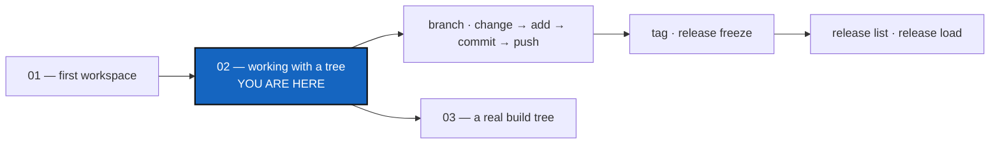

# Tutorial 2 of 8 — Working with a Tree

*Created: 2026-10-06*

## Abstract — read this first

**What this document is.** The second of eight tutorials in
[`tutorials/`](README.md): the commands you use on a READY tree, every
day — a branch of your own, then `add`, `commit`, `push`, `tag` and
`release freeze` across every repository at once, and loading that release
in a workspace that never saw it.

**Why it exists.** Installing a tree is done once; working on it is done
every day. This is where ComplexGitSync replaces running the same Git
command in each repository by hand.

**What you will find.** A quick start, then nine short steps on the
`CGSil1` sandbox, each with its command and what it prints, and a summary.

**Who it is for.** Anyone with the READY `CGSil1` tree from
[Tutorial 1](01_first_multi_repo_workspace.md).

**What you need to do with it.** Work through it once, top to bottom.



---

## Getting started

With `CGSHOME` exported as Tutorial 1 printed it, one change goes round the
whole tree in six commands:

```bash
pixi run cgitsync branch create feature
pixi run cgitsync checkout feature
echo "a first note" > "$CGSHOME/CGSil2/notes.txt"
pixi run cgitsync add
pixi run cgitsync commit "tutorial: a first note"
pixi run cgitsync push --dry-run        # drop --dry-run in a fork of your own
```

Each command acts on every repository of the tree, leaves first, and prints
one line per repository. `push` needs write access: the `CGS_test` sandbox
is read-only for everybody but its author, so fork `CGSil1` and `CGSil2` on
GitLab and `CGSih1` on GitHub, put your account in your copy of
`CGSil1.cgs`, and bootstrap that to run steps 6 to 9 for real.

Over HTTPS, Git asks for credentials when you push: let the provider's tool
give them, once (`glab auth login`; `gh auth login` then `gh auth setup-git`).

---

## Step 1 — See where the tree stands

```bash
pixi run cgitsync status
```

```
summary ready=true complete=true use_case=standalone profile=user cgitsync_branch=main repos=3 dirty=0 ... errors=0
REPOSITORY  PATH    SCOPE    LOCAL_BRANCH  UPSTREAM_BRANCH  LOCAL  SYNC    HEAD      RECORDED
CGSil2      CGSil2  project  main          origin/main      clean  synced  438b2956  438b2956
CGSih1      CGSih1  project  main          origin/main      clean  synced  b44ecb2c  b44ecb2c
CGSil1      .       project  main          origin/main      clean  synced  8b10a333  8b10a333
```

`LOCAL` says whether a repository's files changed; `SYNC` whether it is
level with its remote. The `summary` names the branch the tree is on.

## Step 2 — Work on a branch

`main` is protected on the sandbox, as on most shared projects: work reaches
it through a merge request. Your work goes on a branch, made in every
repository at once:

```bash
pixi run cgitsync branch create feature
pixi run cgitsync checkout feature
pixi run cgitsync branch list
```

```
cgitsync_branch=feature  (origin as of the last fetch; cgitsync fetch refreshes it)
* feature  local          all 3 repositories
  main     local, origin  all 3 repositories
```

`branch create` makes the branch and leaves you where you are; `checkout`
moves the tree (alone, it would also have created it). `*` marks the current
branch, the second column says where it exists, the last which repositories
hold it.

## Step 3 — Change something

```bash
echo "a first note" > "$CGSHOME/CGSil2/notes.txt"
echo "A line added in the tutorial." >> "$CGSHOME/CGSih1/README.md"
pixi run cgitsync status
```

`CGSil2` and `CGSih1` now read `dirty`. You work on plain files with plain
tools; ComplexGitSync only comes in when you record the work.

## Steps 4 and 5 — Stage and commit: `add`, `commit`

```bash
pixi run cgitsync add
pixi run cgitsync commit "tutorial: a first note and a README line"
```

`add` is one `git add --all` in every repository: `staged=3 skipped=0`. The
root has a change too — the `.gitignore` `bootstrap` wrote, listing its
children so the root never records their files. `commit` makes one commit,
with one message, in each repository that had something staged, leaves
first; one with nothing staged is listed as `skipped`.

## Steps 6 and 7 — Publish and mark: `push`, `tag`

```bash
pixi run cgitsync push
pixi run cgitsync tag v0.9
```

`push` prints `pushed CGSil2: origin/feature (upstream set)`, and the same
for the two others: a new branch is published with its upstream, as
`git push -u` would. Someone else updates their copy with `pixi run cgitsync
pull`. `tag` creates `v0.9` in every repository and pushes it.

## Step 8 — Release: `release freeze`

```bash
pixi run cgitsync release freeze "first release of the sandbox"
```

```
release=CGSil1-1 from=next number
READY ... release=CGSil1-1 message='first release of the sandbox' snapshot=.../.cgitsync/state/b2149c25...
```

`add`, `commit`, `pull`, `push`, a tag everywhere, and the release's State
(every repository's exact commit), on the branch you are on. It is named
`<project-name>-<version>`: the root `pixi.toml`'s version, else the next
number; `--force-tag beta` gives `CGSil1-beta`, `--dry-run` shows it first. The
root's tag carries the State (never a private repository), so anyone who can
clone `CGSil1` can load the release.

## Step 9 — Load a release someone else made

A `.cgs` names **branches**, so installing from it gives the latest work; a
release names **commits**. Move the branch on, then play a colleague:

```bash
echo "something we will regret" >> "$CGSHOME/CGSil2/notes.txt"
pixi run cgitsync add
pixi run cgitsync commit "tutorial: a change we will regret"
pixi run cgitsync push
pixi run cgitsync bootstrap "$HOME/CGSil1.cgs" CGSil1-latest --force-protocol https
export CGSHOME=/home/you/.cgs/CGSil1-latest-<timestamp>   # printed by bootstrap
pixi run cgitsync checkout feature     # the .cgs names main; join the branch
pixi run cgitsync release list
```

```
TAG                       VERSION     RECORDED                   BY                  SOURCE
CGSil1-1                  -           2026-10-09T10:40:15+02:00  You                 tag  (made with cgitsync 6.0.0)
```

`SOURCE` is `tag`: the root repository's tag, which this disk never recorded
(the workspace that made it reads `ledger+tag`). Load it:

```bash
pixi run cgitsync release load 1 --force-protocol https
cat "$CGSHOME/CGSil2/notes.txt"          # a first note
pixi run cgitsync checkout feature       # back to work
```

`1` is enough: the project's name is added. Every repository is detached at
the recorded commit, on any machine, and no branch moved; uncommitted changes
stop the load before anything moves. To fix the release itself, `branch
create fix-1` then `checkout fix-1`. To see it beside your workspace, add
`--workspace CGSil1-1`. `feature` reaches `main` by merge request, or by
`merge` ([Tutorial 7](07_merge.md)).

## Summary

| Step | Command | What it does |
|---|---|---|
| 1 | `status` | Where every repository stands |
| 2 | `branch create <name>`, `checkout <name>`, `branch list` | A branch in every repository; move to it; list them |
| 4 | `add` | Stage every change, in every repository |
| 5 | `commit "message"` | One commit per changed repository, one message |
| 6 | `push` / `pull` | Publish what is ahead (a new branch gets its upstream) / bring it up to date |
| 7 | `tag <name>` | Tag every repository and push the tag |
| 8 | `release freeze "message"` | Add, commit, pull, push, tag `<project>-<version>`, record the State |
| 9 | `release list`, `release load <version> --force-protocol https` | Every release of the project; put the tree back at one |

Every command is `pixi run cgitsync ...` and takes `--help`. Next:
[Tutorial 3](03_onboarding_a_real_build_tree.md) applies them to a real,
19-repository project.
