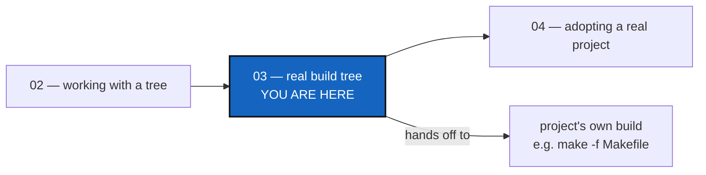

# Tutorial 3 of 8 — Onboarding a Real Build Tree

*Created: 2026-08-25*

## Abstract — read this first

**What this document is.** The third of eight tutorials in
[`tutorials/`](README.md): the hand-authored `.cgs` style from
[Tutorial 1](01_first_multi_repo_workspace.md) applied to a real,
19-repository hydrological simulation platform (`cawaqs`), then handed off
to that project's own build.

**Why it exists.** To show that hand-authoring a `.cgs` scales to a real,
much larger project without getting more complicated, and to draw the line
between what `cgitsync` does (fetch repositories, select branches) and what
it leaves to the project's own build system.

**What you will find.** A quick start, what `examples/cawaqs.cgs` covers and
what it does not, the spec itself, a five-step walkthrough (`validate` →
`bootstrap` → `view-tree` → `checkout` → `make`), and a summary.

**Who it is for.** Anyone who has done Tutorials 1 and 2 and wants to see
the same habits on a project of real scale.

**What you need to do with it.** Read it, then go on to
[Tutorial 4](04_adopting_a_real_project.md) for a project with no `.cgs` of
its own that still uses git submodules.



---

## Getting started

From your ComplexGitSync clone, the whole 19-repository tree in four
commands, then the project's own build:

```bash
pixi run cgitsync validate examples/cawaqs.cgs
pixi run cgitsync bootstrap examples/cawaqs.cgs cawaqs-smoke-test --force-protocol https
export CGSHOME=/home/you/.cgs/cawaqs-smoke-test-<timestamp>   # printed by bootstrap
pixi run cgitsync checkout my-feature-branch
cd "$CGSHOME" && make -f Makefile
```

`validate` clones nothing. `bootstrap` clones every repository into a new
workspace. `checkout` puts each library on `my-feature-branch` where it
exists and on `main` where it does not, which is the rule `cawaqs` already
follows. `make` is the project's, not `cgitsync`'s: the tool stops at a
READY tree. The rest of this tutorial explains each of these steps.

---

## 1. What `examples/cawaqs.cgs` covers, and what it does not

`cawaqs` is built from 17 C/Fortran libraries plus one build-tooling
repository, 19 repositories in all, spread across five GitLab groups. The
`.cgs` captures that topology:

- the root repo `gitlab:cawaqs/cawaqs`;
- 17 library repositories across the `gutil`, `ghydro`, `gmesh`, `gtransp`
  and `gmanagement` groups;
- the required `gitlab:gutil/scripts` helper repo, a plain nested
  dependency: it is build tooling, has no `.cgs` of its own, and the default
  `nested_config = "auto"` already resolves it as a normal leaf.

Despite the scale, this `.cgs` is *simpler* than `CGSil1`'s: no entry needs
a `relative_path`, because the layout each library expects already matches
`cgitsync`'s default. Scale and `.cgs` complexity are independent: the
topology is written from what the project's build script and documentation
already say, not derived by scanning a checkout.

**`cgitsync` is not the `cawaqs` build system.** It replaces only the
*repository-fetching and branch-selection* half of the historical
`make_Cawaqs.sh` / `make_Cawaqs_from_branches.sh` scripts. Once the tree is
READY, you run the project's own build (for example `make -f Makefile`);
`cgitsync` never invokes `make`.

Only the *nested* installation layout is representable: every child lives
inside the root checkout. `cawaqs` also supports a shared
`LIB_HYDROSYSTEM_PATH` mode (several checkouts sharing one set of compiled
libraries installed outside all of them); that has no equivalent in
`cgitsync`'s containment model and stays out of scope. Leave
`LIB_HYDROSYSTEM_PATH` unset, or point it at the bootstrapped root, so the
`Makefile` finds the library directories `cgitsync` created.

## 2. Project spec — `examples/cawaqs.cgs`

```toml
project = { name = "cawaqs", default_branch = "main" }

repos = [
    { repository = "gitlab:cawaqs/cawaqs", relative_path = ".", fallback_branch = "main" },
    { repository = "gitlab:gutil/libgc", fallback_branch = "main" },
    { repository = "gitlab:gutil/libpc", fallback_branch = "main" },
    { repository = "gitlab:gutil/libts", fallback_branch = "main" },
    # ... 14 more library entries, identical shape, across gutil/ghydro/gmesh/gtransp/gmanagement ...
    { repository = "gitlab:gutil/scripts", fallback_branch = "main" },
]
```

See `examples/cawaqs.cgs` for all 19 entries. Two things are the opposite of
what Tutorial 1's `CGSil1` needed:

- **No `relative_path` overrides.** Unlike `cawaqsviz` in Tutorial 4, every
  library installs at `$PATH_INST/<repo_name>/`, exactly `cgitsync`'s default
  (the bare repository name). At 19 repositories, that keeps the file
  readable.
- **One branch name, with a fallback per repository.** `project.default_branch
  = "main"` plus `fallback_branch = "main"` on every entry mirrors `cawaqs`'s
  own convention (from its `README.md`): *"the name of the branch is the same
  in each library; if the branch doesn't exist in the library, then the main
  branch is used as default."* `checkout <branch>` reproduces this exactly.

## 3. Step-by-step walkthrough

Like Tutorial 1, this uses **standalone mode** (`bootstrap`): one
`cgitsync` clone reused across projects. `cawaqs` works nested too;
standalone is simply the usual choice.

### Step 1 — Validate the topology

Offline, no cloning:

```bash
pixi run cgitsync validate examples/cawaqs.cgs
```

### Step 2 — Bootstrap the tree

Clones all 19 repositories into a fresh, isolated workspace, and prints its
`export CGSHOME=...` line; run that line:

```bash
pixi run cgitsync bootstrap examples/cawaqs.cgs cawaqs-smoke-test --force-protocol https
```

### Step 3 — Inspect the tree

```bash
pixi run cgitsync view-tree --search-dir <path bootstrap printed>
```

### Step 4 — Move the whole tree to a shared branch

One call retargets all 19 repositories to `my-feature-branch`, falling back
to `main` in each repository where that branch does not exist. This is
`make_Cawaqs_from_branches.sh -b <branch_name>`'s repository-selection step:

```bash
pixi run cgitsync checkout my-feature-branch
```

### Step 5 — Hand off to the project's own build

`cgitsync`'s job ends here. From the bootstrapped root:

```bash
export LIB_HYDROSYSTEM_PATH=  # unset, or point at the bootstrapped root
make -f Makefile
```

## 4. Summary

| Step | Command | Description |
|------|---------|-------------|
| 1 | `pixi run cgitsync validate examples/cawaqs.cgs` | Parse and check the topology |
| 2 | `pixi run cgitsync bootstrap examples/cawaqs.cgs cawaqs-smoke-test --force-protocol https` | Clone all 19 repos into an isolated `CGSHOME` |
| 3 | `pixi run cgitsync view-tree --search-dir <path>` | Render the tree summary |
| 4 | `pixi run cgitsync checkout my-feature-branch` | Retarget the whole tree, with a fallback per repository |
| hand-off | `make -f Makefile` (the project's own build) | Out of scope for `cgitsync`: compiles the checked-out tree |

`discover` (Tutorial 4) is **not** a route into this file: the 17 libraries
never sit together in one directory tree until *after* a `.cgs` already lists
them, so there is no single checkout for a filesystem walk to scan. Writing
`examples/cawaqs.cgs` from the project's own `Makefile` and `README.md`, as
this tutorial does, is the only route.
