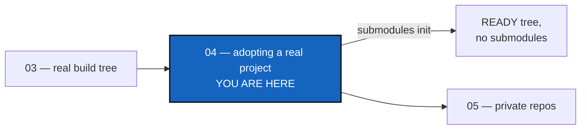

# Tutorial 4 of 8 — Adopting a Real Project: CaWaQS-Viz

*Created: 2026-09-02*

## Abstract — read this first

**What this document is.** One real, tested, end-to-end procedure for
bringing an existing project, **`cawaqsviz`**
(<https://gitlab.com/cawaqs/gviz/cawaqsviz>), under ComplexGitSync. It has no
`.cgs` of its own and still uses git submodules, on two levels.

**Why it exists.** Tutorials 1 to 3 write a `.cgs` for a project you
understand. This one starts from a real project you do not control and walks
every step in the order you would run it: one path, verified against the
live repositories.

**What you will find.** A quick start, then seven steps: clone, check out
the submodules, adopt the tree with `submodules init`, then branch, check
out, commit and push. §3.1 explains why step 3's order cannot change.

**Who it is for.** Anyone adopting a project that lacks a `.cgs` and still
uses git submodules — the messiest starting point of the tutorials.

**What you need to do with it.** Follow the steps in order. The directory
name in step 1 is the one thing worth reading twice.



---

## Getting started

Clone the project into a directory named exactly like it, check out every
submodule, then adopt the whole tree from your ComplexGitSync clone:

```bash
export WORK=/home/user/work && mkdir -p "$WORK"
git clone https://gitlab.com/cawaqs/gviz/cawaqsviz.git "$WORK/cawaqsviz"
git -C "$WORK/cawaqsviz" submodule update --init --recursive
cd /path/to/ComplexGitSync
pixi run cgitsync submodules init "$WORK/cawaqsviz" --force-protocol https --dry-run
pixi run cgitsync submodules init "$WORK/cawaqsviz" --force-protocol https
export CGSHOME="$WORK/cawaqsviz"
pixi run cgitsync branch create retire-submodules
pixi run cgitsync checkout retire-submodules
pixi run cgitsync add
pixi run cgitsync commit "chore: retire git submodules in favour of ComplexGitSync"
```

The tree is READY, with every submodule turned into a plain nested clone and
the conversion committed on a branch of its own. Push it only through a merge
request: it is a visible change to a shared project (step 7).

---

The project is four repositories on two levels. `HydrologicalTwinAlphaSeries`
is a **parent**: it holds a submodule of its own, which is what the
`--recursive` flags are for.

```
cawaqsviz  (GitLab: cawaqs/gviz/cawaqsviz, root)
  ├── HydrologicalTwinAlphaSeries  (GitHub submodule, at external/HydrologicalTwinAlphaSeries)
  │     └── hydrological_twin      (GitHub submodule, at docs/hydrological_twin)
  └── user_guide_CaWaQS-Viz        (GitHub submodule, at docs/CWV_user_guide)
```

Every `cgitsync` command runs from your ComplexGitSync clone (standalone
mode) and takes an absolute path to `cawaqsviz`; never run it from inside
`cawaqsviz`.

## 1. Clone the project

**Name the clone directory `cawaqsviz`, and nothing else.** Step 3 takes the
project name from the root's identifier (`cawaqs/gviz/cawaqsviz` →
`cawaqsviz`), not from the directory, then looks for the workspace at
`<parent>/<project name>`. Any other name is refused up front, with a request
to rename.

## 2. Update the submodules

`git submodule update --init --recursive` checks out both levels. Without
`--recursive`, `hydrological_twin` stays an empty directory, and `discover`,
which reads the filesystem, cannot find a repository that is not checked out.

> **If GitHub answers `HTTP 401` / `expected flush after ref listing`**, it
> refused the anonymous fetch. Authenticate HTTPS once with `gh auth login`
> then `gh auth setup-git`, and run the update again. With an SSH key on
> GitHub, `git -c url."git@github.com:".insteadOf="https://github.com/"
> submodule update --init --recursive` does it over SSH for this clone only.

## 3. Adopt the tree with `submodules init`

One command drafts the `.cgs`, builds the tree, and converts every submodule
at both levels. The dry run touches nothing:

```
Found 4 git repository(ies) under /home/user/work/cawaqsviz
project name: cawaqsviz
  would write:  /home/user/work/cawaqsviz/cawaqsviz.cgs
  would adopt:  /home/user/work/cawaqsviz (CGSHOME)
  would convert 3 submodule(s):
    - docs/CWV_user_guide  (declared in .gitmodules)
    - external/HydrologicalTwinAlphaSeries  (declared in .gitmodules)
    - external/HydrologicalTwinAlphaSeries/docs/hydrological_twin  (declared in external/HydrologicalTwinAlphaSeries/.gitmodules)
```

Paths count from the directory you named, and `declared in` names the
`.gitmodules` each came from. `hydrological_twin`, four levels down, is found
because the scan has no depth limit unless you pass `--max-depth`; a limit
that cuts the walk short is reported as a warning. The real run ends READY,
drawing `HydrologicalTwinAlphaSeries (parent)` with `hydrological_twin`
under it. That nesting is what keeps `docs/hydrological_twin` in the parent's
own `.gitignore`, so the next `add` never turns the clone back into a
submodule. It ends by printing `export CGSHOME=/home/user/work/cawaqsviz`.

### 3.1 What it runs underneath, and why the order is fixed

```bash
pixi run cgitsync discover "$WORK/cawaqsviz" --write "$WORK/cawaqsviz/cawaqsviz.cgs"
pixi run cgitsync initialise "$WORK/cawaqsviz/cawaqsviz.cgs" --output-path "$WORK" --force-protocol https
pixi run cgitsync submodules import "$WORK/cawaqsviz" --recursive --now
```

1. **`discover`** drafts the `.cgs` from what is checked out, with
   `hydrological_twin` as `HydrologicalTwinAlphaSeries`' child. It records
   the root's checked-out branch as `project.default_branch`; if that is not
   the branch you are adopting, fix it in the draft before going on.
2. **`initialise`** adopts the root at `--output-path/<project-name>` in
   place and clones everything else — the step-1 naming rule.
3. **`submodules import --recursive --now`** turns each gitlink into a plain
   clone: `git rm --cached`, its `.gitmodules` stanza removed, its path
   added to that repository's `.gitignore`.

> **The conversion must come last.** `initialise` deletes and re-clones every
> repository but the root, from remotes that still use submodules. Convert
> first, and `HydrologicalTwinAlphaSeries` comes back with its submodule
> intact; a second `import` then reports "nothing to import", because the
> root's `.gitmodules` it walks from is gone. `bootstrap` is no route either:
> it refuses a destination that is not empty, and elsewhere would adopt a
> fresh copy instead of your checkout.

## 4 and 5. Branch and check out

`branch create retire-submodules` then `checkout retire-submodules` make a
local branch across the tree, as in [Tutorial 2](02_working_with_a_tree.md).
A repository marked `private = true` keeps its own branch
([Tutorial 5](05_private_repos.md)).

## 6. Stage and commit

Two repositories have something to commit, because step 3 converted two
levels:

```
$ git -C "$WORK/cawaqsviz" status --porcelain
D  .gitmodules
D  docs/CWV_user_guide
D  external/HydrologicalTwinAlphaSeries
?? .gitignore
?? cawaqsviz.cgs
```

`HydrologicalTwinAlphaSeries` shows the same kind of change for its own
submodule. `add` also stages `cawaqsviz.cgs`, so from this commit on the
project carries its own topology and anyone can rebuild it with
`initialise`. The new `.gitignore` holds `.cgitsync/` and `cawaqsviz.lgr`
(ComplexGitSync's own state) and one line per child repository.

## 7. Push, or freeze a release

```bash
pixi run cgitsync push
pixi run cgitsync release freeze "retire git submodules" --force-tag retire-submodules-v1
```

`push` publishes the new branch with its upstream. `release freeze` does
`add → commit → pull → push → tag` and records the State, tagged
`cawaqsviz-retire-submodules-v1`; it skips `pull` on a branch never
published. If `push` says `could not read Username`, the tree needs HTTPS
write credentials: `glab auth login` (or `gh auth login`, `gh auth
setup-git`), then push again, or `push --force-protocol ssh` with an SSH key,
which switches the remotes for good.

> **Live migration note.** Pushing this to the real `cawaqsviz` is a
> permanent change to a shared project, half of it on a GitHub repository
> you may not own. Open a merge request rather than pushing to `main`.

## 8. Summary

| Step | Command | Description |
|------|---------|-------------|
| 1 | `git clone .../cawaqsviz.git "$WORK/cawaqsviz"` | Clone, named like the project |
| 2 | `git submodule update --init --recursive` | Check out every submodule, both levels |
| 3 | `pixi run cgitsync submodules init "$WORK/cawaqsviz" --force-protocol https` | Draft the `.cgs`, adopt the root, clone the rest, convert every submodule |
| 4–5 | `branch create retire-submodules`, `checkout retire-submodules` | A local branch across the tree |
| 6 | `add`, `commit "..."` | Stage and commit the conversion |
| 7 | `push`, or `release freeze MSG` | Publish the branch, or cut a release |

With a `.cgs` of your own, pass it as `--cgs FILE`; the rest is unchanged.
`examples/cawaqsviz.cgs` is a hand-written `.cgs` for the same topology. To
mount shared documents or agent instructions as well, see
[Tutorial 5](05_private_repos.md).
