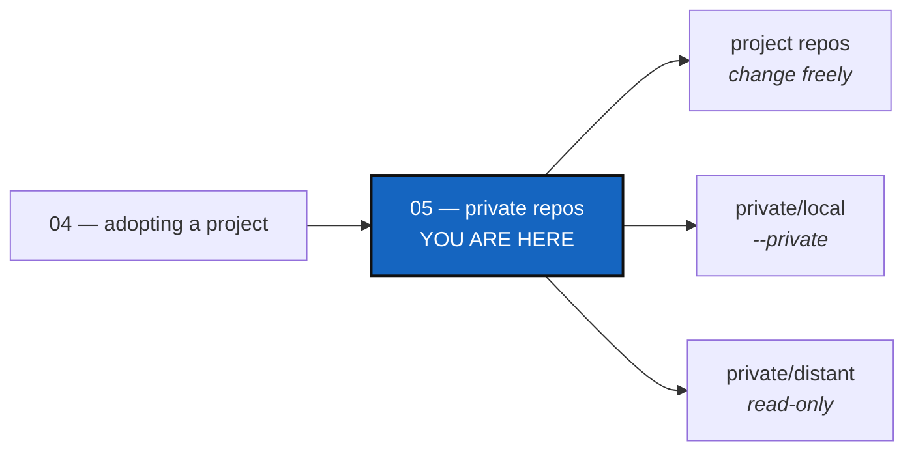

# Tutorial 5 of 8 — Private repos: the ones that configure your project

*Created: 2026-09-07*

## Abstract — read this first

**What this document is.** How to keep the repositories that *configure*
your project apart from the ones that *are* your project, so work in one
project never leaks into the others that share them.

**Why it exists.** A shared repository is not yours to change freely. Once
`cgitsync` knows which is which, it keeps you out of trouble by default.

**What you will find.** A quick start, the two kinds of private repository
(§1, §2), their branch rule (§3), how to declare them (§4), the everyday
commands (§5) and a summary (§6).

**Who it is for.** Anyone whose projects share documents or settings, after
[Tutorial 1](01_first_multi_repo_workspace.md).

**What you need to do with it.** Read §2, then follow §5. The commands do the
safe thing unless you ask otherwise.



---

## Getting started

Mark a shared repository `private = true` in your `.cgs`; add
`writable = true` if this project may write to it:

```toml
{ repository = "github:flipoyo/DocSpec", relative_path = ".agent/.distant/documentation", default_branch = "main", fallback_branch = "main", private = true },
{ repository = "github:flipoyo/.localSpec", relative_path = ".agent/.local/.localSpec", default_branch = "MyProject", fallback_branch = "main", private = true, writable = true },
```

```bash
pixi run cgitsync initialise <your.cgs>                          # SSH, the default
pixi run cgitsync status                                         # the SCOPE column
pixi run cgitsync commit "my change"                             # your project's repos only
pixi run cgitsync commit --private "my notes"                    # your writable private repos only
```

`status` labels each repository `project`, `private/local` or
`private/distant`. A plain `commit` never touches a private repository;
`--private` reaches the writable ones; nothing ever writes a read-only one.

---

> **This tutorial stays on SSH**: it works on ComplexGitSync's own developer
> tree, whose private repositories need a developer's credentials anyway. To
> try it without an SSH key, clone with HTTPS credentials that reach them:
> `pixi run cgitsync initialise <your.cgs> --force-protocol https`.

## 1. Project repos and private repos

**Project repos** are the work itself, and follow your project's branch.
**Private repos** are how it is run — pipelines, agent instructions, review
rules — one copy shared by all your projects. They must not follow your
feature branch, or every project sharing them would see half-finished work.

## 2. The two kinds — the part that matters

The difference is **who may write**.

- **private/distant** — someone else's repository. You read it; only its
  owner writes. Example: a house-style document a dozen projects mount.
- **private/local** — shared, but the part you use is yours, on a branch
  named after your project, which nobody else reads. Example: your
  project's notes and agent instructions.

**Private means distant unless you say otherwise.** `private = true` alone is
private/distant; `writable = true` makes it private/local. The expensive
mistake is writing to something shared by accident, never the reverse. When
you cannot write where you expected, `cgitsync` names the repository and
what to add to the `.cgs`. This repository's own tree uses both:

```text
REPOSITORY         PATH                           SCOPE            LOCAL_BRANCH
DocComplexGitSync  docs                           project          multi-branch
.ticketing         .agent/.distant/ticket         private/distant  main
DevSpec            .agent/.distant/dev-sync       private/distant  main
DocSpec            .agent/.distant/documentation  private/distant  main
.dev               .agent/.local/.dev             private/local    ComplexGitSync_multi-branch
.localSpec         .agent/.local/.localSpec       private/local    ComplexGitSync_multi-branch
.claude            .agent/.local/.claude          private/local    ComplexGitSync_multi-branch
ComplexGitSync     .                              project          multi-branch
```

| `SCOPE` | What it is | What writes to it |
|---|---|---|
| `project` | this project's own | `commit`, `push` |
| `private/local` | shared, and yours to write | the same, with `--private` |
| `private/distant` | shared, read-only | nothing |

**The branch name is the tell.** On a branch named after your project: yours.
On `main`: everybody's. `.agent/` is never itself a repository, only a plain
directory these paths share; a writable repository nested *inside* a
read-only one would be capped read-only, so none of them nest.

## 3. A branch per project branch

`.localSpec` above is on `ComplexGitSync_multi-branch`, because the project
is on `multi-branch`. The rule has one shape:

```text
branch X  ->  project repos:   X
              private/local:   <your project's name>          if X is main
                               <your project's name>_X        otherwise
```

The separator is `_` because hyphens already occur inside branch names. A
branch per project branch keeps notes about an unfinished feature off
`main` until the feature lands. **You never type the second name**:
`checkout multi-branch` puts each kind on its own branch, creating the
private one if needed, and `branch create` does the same without moving.

## 4. Declaring them

```toml
project = { name = "ComplexGitSync", default_branch = "CGS-ALPHA" }

repos = [
    { repository = "github:flipoyo/ComplexGitSync", fallback_branch = "CGS-ALPHA", nested_config = "disabled" },
    { repository = "github:flipoyo/DocComplexGitSync", relative_path = "docs", fallback_branch = "CGS-ALPHA", nested_config = "disabled" },
    { repository = "github:flipoyo/.ticketing", relative_path = ".agent/.distant/ticket", default_branch = "main", fallback_branch = "main", private = true },
    { repository = "github:flipoyo/DevSpec", relative_path = ".agent/.distant/dev-sync", default_branch = "main", fallback_branch = "main", nested_config = "disabled", private = true },
    { repository = "github:flipoyo/.localSpec", relative_path = ".agent/.local/.localSpec", fallback_branch = "main", private = true, writable = true },
]
```

An excerpt of [`examples/cgitsync-alpha.cgs`](../examples/cgitsync-alpha.cgs), which types no branch for a private, writable entry;
the user install, `install.cgs`, stops after the first two entries. For a
`private, writable` entry the branch is **computed**: the project's name on
`main`, `<project>_<branch>` elsewhere. A `default_branch` that is neither
that name nor the project's own default is refused as a copy-and-paste
mistake. Until your first private commit creates that branch, a clone falls
back to `fallback_branch`. A repository declared in another one's nested
`.cgs` inherits its parent's privacy, and may narrow it but never widen it.

**When your project nests another project's tree**, that project's `.cgs` may
ask for the same shared repositories at the same paths. Your `.cgs` is a
request and the State is what the tree holds: a request for a repository you
already hold on that branch, or for a path already used, is refused before
cloning and printed as `denied:`. The nested project's own private
repositories sit on `<its name>_<your project>`, never sharing a branch with
yours.

## 5. Working day to day

**Your project's own work** needs nothing special: `branch create`,
`checkout`, `add`, `commit`, `push`. Each command says what it left out:

```text
scope=project skipped=5 configuration repo(s) (.claude, .localSpec with --private)
```

**Your own private repos** take `--private`, which reaches the writable ones
and only those: `add --private`, `commit --private "..."`, `push --private`.
That gives two commits with two messages, usually what you want. **Both at
once**, when it really is one change: `add --all`, `commit --all "..."`,
`push --all`. Read-only repositories are never written by any of the three;
`--all` and `--private` do not combine. `--private` is taken by `pull`,
`fetch`, `checkout`, `branch`, `add`, `rm`, `commit`, `merge`, `push` and
`tag`; on a tree with no writable private repository it stops and says why.

**Merging** works the same way: check out the target, then `merge
multi-branch --all` checks *every* repository before merging *any*, so a
conflict in a private one leaves your project repos untouched too.
[Tutorial 7](07_merge.md) covers merging, conflicts and `--resolve` in full.

**A read-only repo** is never changed by `cgitsync`, in any mode. When you
must change a shared document, do it deliberately with plain Git, after your
own work is reviewed:

```bash
git -C .agent/.distant/ticket add TICKETLIFECYCLE.md
git -C .agent/.distant/ticket commit -m "what you changed"
git -C .agent/.distant/ticket push
```

Everyone mounting it sees it on their next pull. This is a safety rail, not
a lock: `cgitsync` refuses, `git` does not. `pull` reaches every repository,
read-only ones included; `tag` skips read-only ones, whose exact commit the
State records anyway.

## 6. Summary

| What you want | Command | What it touches |
|---|---|---|
| Work on your project | `add` / `commit` / `push` | your project's repos only |
| Update your own notes/config | the same, plus `--private` (or `--all`) | your writable private repos (or both) |
| Change a shared document | plain `git -C <repo> ...` | that one repo, deliberately |
| Get everyone's latest | `pull` | everything |
| Cut a release | `tag` | everything you may write |
| See where you stand | `status`, `view-tree` | everything |

**Private means shared; shared means read-only** unless the `.cgs` says
`writable = true`. `private` covers configuration only: data repositories,
with their own size and versioning rhythm, are not defined yet. The full
branch model is in the user guide, *Branches in a `.cgs`*
([docs/MASTER.pdf](../docs/MASTER.pdf)).
