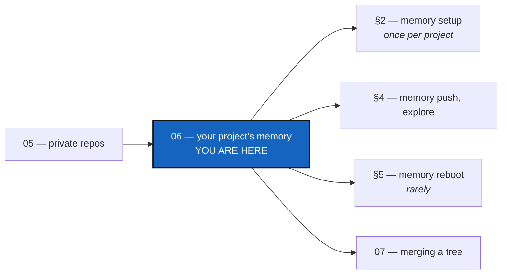

# Tutorial 6 of 8 — Your project's memory: keeping it, reading it, and starting it over

*Created: 2026-09-17*

## Abstract — read this first

**What this document is.** How to give a project a **memory** — the record
of what `cgitsync` did, kept in a repository of its own — that follows your
project across branches and machines, can be read without a hash, and can be
started over on purpose without losing what came before.

**Why it exists.** Every command already writes a memory into `.cgitsync/`,
on one disk. Turning it into a repository takes one command, `memory setup`,
run at any time, or the five it stands for, once per project.

**What you will find.** A quick start, what a memory is and where it lives
(§1), giving it a repository (§2), how it follows your branches (§3), the
daily commands (§4), starting it over (§5), a second machine (§6) and a
summary (§7).

**Who it is for.** Anyone with a working tree, after
[Tutorial 5](05_private_repos.md): a memory is a private repository.

**What you need to do with it.** Do §2 once, on a real project; then §4 is
all you need, until the day you need §5.



---

## Getting started

On a developer's tree (`status` says `profile=dev`) whose `.cgs` declares no
memory, with an SSH key registered at your provider (`ssh -T git@github.com`)
and its command-line tool signed in (`gh auth login`):

```bash
pixi run cgitsync memory status                     # what is remembered so far
pixi run cgitsync memory setup --provider github --owner you --name .memory
pixi run cgitsync memory push                       # fold, commit and push it
pixi run cgitsync memory branch --project-branch main   # once, if you work off main
pixi run cgitsync memory explore                    # read it, no hash needed
```

`memory setup` creates the repository through your provider's tool, adds
one entry to your `.cgs` (comments kept), and turns the memory already on
disk into that repository, keeping every record. `memory push` sends it. From
then on `checkout`, `merge` and `push` carry it like any private repository.
`cgitsync` never reads, stores or sends a password or token.

---

## 1. What a memory is, and where it lives

Every command that changes your tree writes a **State** (what the whole tree
looked like, named after its own contents, so the same tree has the same
name on any machine) and a **ledger entry** (that an operation happened,
when, with which tool versions, and what it committed). Together they answer
what Git cannot: *what did this whole tree look like on release day?*

```
$ pixi run cgitsync memory status
states=14 entries=31 verification=verified findings=0 folded=28 pending=3
```

It lives in two directories. **`.cgitsync/`** is the workspace's live state,
written by every command: the **pending** half. Its run logs, in
`.cgitsync/logs/`, never leave the machine, and only the 200 newest are
kept. **`.cgitsync/.memory`** is the git-tracked repository, an ordinary
private/local one: the **folded** half, what the last `memory push`
committed. Only `memory push` moves content from one to the other. A memory
adopted before this split sits at `.cgitsync` itself; `memory migrate`
moves it once, in place, history unchanged.

With no memory declared, `cgitsync` makes a local one there, never pushed
until the `.cgs` declares it and you run `memory adopt`; a developer's tree
is offered `memory setup` once. A memory holds no source: only what the tree
*was* and what `cgitsync` *did*.

## 2. Giving your memory a repository

`memory setup` (see *Getting started*) runs steps 1 to 3 below and stops at
the first that fails, naming it; `--cgs FILE` names the `.cgs` to edit. The
memory's remote is always SSH, whatever protocol the tree uses; `pull
--force-protocol ssh` switches the whole tree too, changing no State.

**Step 1 — create the repository**, once for all your projects (one branch
per project): `pixi run cgitsync repo create github:YOURNAME/.memory`. It
runs `gh` (or `glab`, `tea`); a missing or signed-out tool is named, and a
repository already there gives `created=already-there`.

**Step 2 — declare it**: `pixi run cgitsync memory mount --cgs
examples/cgitsync-alpha.cgs` adds one line to `repos`, leaving the rest
of the file as it was:

```
entry={ repository = "github:YOURNAME/.memory", relative_path = ".cgitsync/.memory", default_branch = "ComplexGitSync", fallback_branch = "main", private = true, writable = true, nested_config = "disabled" },
```

`nested_config = "disabled"` keeps its `.cgs/` folder of exported shapes
(§5) from being read as a nested project.

**Step 3 — adopt it**: `pixi run cgitsync memory adopt` creates
`.cgitsync/.memory` fresh, as that repository, on your project branch's
memory branch, starting from its fallback branch (`started_from=origin/main`).
It starts empty; the records wait in `.cgitsync/` for step 4. `--reboot`
starts it with no inherited history instead.

**Step 4 — push**: `pixi run cgitsync memory push` folds what is pending,
commits and pushes it. From here, losing the disk no longer matters.

**Step 5 — the branch your first merge needs.** The memory branch follows the
project branch (`YourProject_memory-dev`, or `YourProject` on `main`), so a
memory born on a feature branch has nothing to merge into: run `memory branch
--project-branch main` once. Forget it, and the merge names this command.

## 3. The memory follows your branches

```bash
pixi run cgitsync checkout main
pixi run cgitsync merge memory-dev --all
pixi run cgitsync push --all
```

`checkout`, `merge` and `push` reach `.cgitsync/.memory` like any private
repository, with one difference: **a memory is kept, never merged.** It is a
hash chain of numbered files, and two memories that grew apart hold
different entries under the same numbers. So `merge` keeps the memory of the
branch you merge *into* whole and records the other as history:

```
kept .memory: its own memory stays whole; YourProject_memory-dev is kept as history
```

To continue the other chain instead, say which (never guessed):

```bash
pixi run cgitsync memory merge memory-dev --into main --theirs   # keep memory-dev's
pixi run cgitsync memory merge memory-dev --into main --ours     # keep main's (what merge did)
```

## 4. Day to day

```bash
pixi run cgitsync memory status         # how much is remembered, does it verify
pixi run cgitsync memory list           # every State, newest first
pixi run cgitsync memory show 2acdc98b  # one State: what was committed, and by whom
pixi run cgitsync memory explore        # published commits, newest push first
pixi run cgitsync memory explore --timeline   # every ledger entry, in order
pixi run cgitsync memory as-of 2026-09-30T17:00   # the State at or before a time (UTC)
pixi run cgitsync memory push           # send what it has gained
```

`memory push` is always typed, never automatic; offline, a memory stays
complete and verifiable. `as-of` takes a bare date (its end of day) or a
time, and flags `answer_reliable=false` when the chain does not verify or a
clock went backwards. `cgitsync verify check` answers **verified**,
**no-history**, **legacy** or **corrupt**, and never repairs anything.

## 5. Starting a memory's history over

When the project's shape has changed, `memory reboot` closes the chapter:

```
folded=12 pending record(s)
archived=YourProject_memory-dev -> YourProject_memory-dev.archived-20260918
exported=.cgitsync/.memory/.cgs/YourProject-v2.cgs
branch=YourProject_memory-dev (fresh, empty)
```

1. What is pending is folded and pushed first, so nothing is lost.
2. The tree's current shape is exported, from the `.gts`, to
   `.cgitsync/.memory/.cgs/<project>-v<N>.cgs`; `N` is never reused.
3. The branch is pushed as `<branch>.archived-<date>` *before* its old name
   leaves origin, so its commits are always reachable.
4. A fresh, empty branch takes the original name. It is local until you run
   `memory push`, which also sets its upstream (`memory branch` does not).

Nothing is force-pushed or deleted: `memory clone --branch
YourProject_memory-dev.archived-20260918` brings the old chapter back, and
`verify check` answers on it as before. Reboot acts on the branch checked
out: to fold a long branch into `main`, merge first, then reboot on `main`.

## 6. On a second machine

`pixi run cgitsync memory clone`, then `memory status`: the same numbers as
§1, all of them folded, since a clone brings only what was pushed.

## 7. Summary

| When | Command | What it does |
|---|---|---|
| Once per project | `memory setup [--provider --owner --name]` | Create, declare and adopt, in one command |
| Once, ever | `repo create <provider:owner/.memory>` | The repository, through your provider's tool |
| Once per project | `memory mount --cgs FILE`, `memory adopt [--reboot]` | Declare it; make your memory that repository |
| Once per project | `memory branch --project-branch main` | The branch your first merge needs |
| Whenever | `memory push`, `memory explore [--timeline]`, `memory as-of` | Send it; read it without a hash |
| Two branches meet | `memory merge BRANCH [--into TARGET] --ours\|--theirs` | Keep one chain whole, the other as history |
| Rarely | `memory reboot` | Archive the branch, export the shape, start fresh |
| New machine | `memory clone [--branch NAME]` | Bring it back, live or archived |

Nothing here is automatic, `cgitsync` holds no credential, and nothing is
ever force-pushed or deleted.
