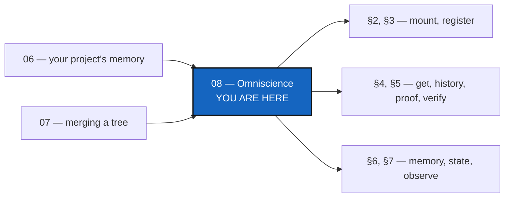

# Tutorial 8 of 8 — Omniscience: register your project's history, and ask for it from anywhere

*Created: 2026-10-21*

## Abstract — read this first

**What this document is.** How a developer registers a project's memory in
the shared register, Omniscience, and how anyone the register's provider
lets in finds a project by name, lists its branches and history, gets a State
with a checkable proof, reads the registered `.memory`, asks whether the
repositories are still there, and restores the project on another machine.

**Why it exists.** A memory ([Tutorial 6](06_memory.md)) lives on one
developer's disk and remote. Omniscience is where the memories of many
projects meet, without being merged or copied. It is worth exactly what a
reader can check, so this tutorial teaches checking as much as asking.

**What you will find.** A quick start, what it is (§1), joining and
registering (§2, §3), asking (§4), proofs (§5), reading and restoring (§6),
availability (§7), the five answers (§8), a summary (§9), and the GX4G gate
(§10).

**Who it is for.** A developer with private repositories
([Tutorial 5](05_private_repos.md)) and a published memory. Reading needs
only access to the register.

**What you need to do with it.** Read §1 and §8 first; do §2 and §3 once per
project, and §4 to §7 whenever you need to ask.



---

## Getting started

On a developer's tree with a published memory, join the register, register
your newest State, and ask for it back. The examples use a project
`MyProject` and a State whose hash begins `3f9a` (`memory list` shows yours;
any unambiguous beginning of a hash will do):

```bash
pixi run cgitsync omniscience mount --contribute
pixi run cgitsync memory push
pixi run cgitsync omniscience register --state 3f9a
pixi run cgitsync omniscience get MyProject
pixi run cgitsync omniscience verify MyProject 3f9a
pixi run cgitsync omniscience state MyProject 3f9a --out restored.gts
```

Every answer starts with `status=` and exits 0 only for `verified`. `verify`
checks the State's proof and judges the register itself; `state --out`
writes a `.gts` that rebuilds the project on any machine (§6).

---

## 1. What Omniscience is

One private repository, `omniscience`, shared by every registered project.
For each project branch it holds one small **record** per registration —
which State, tree root and ledger tip, and which `.memory` repository and
**commit** hold them — and no State, no source, no credential. Over the
records sits a **checkpoint**, a Merkle root over every accepted record, and
each new checkpoint names the one before. So:

- **A record is a promise you can check**: a reader fetches the commit it
  names and tests it against the record.
- **Nothing is ever removed or rewritten.** A repository that vanishes is
  noted *beside* its registration, never instead of it.
- **A proof is not an availability check.** "Registered" and "still there"
  are two questions with two commands, and no answer confuses them.

## 2. Join the register

`omniscience mount --contribute` adds the register to your `.cgs`, writable,
and clones your project's branch of it (or the index branch, if your project
has none yet) at `.omniscience`. Without `--contribute` it is read-only,
which is all a reader needs. A user's tree, with no private repository, is
refused by name.

## 3. Register a State

A record is built only from your **committed** memory, so a reader can fetch
what it names: `memory push` first. Then `omniscience record 3f9a` prints
what would be registered and its hash, and `omniscience register --state
3f9a` validates it, appends it to your project's branch of the register by
name (creating the branch if needed), and extends the checkpoint. Without
`--state` it takes the newest State; run twice, it does nothing twice. Two
developers registering at once never force: the loser retries from the
winner's tip and lands second.

## 4. Ask by name

```bash
pixi run cgitsync omniscience get MyProject
pixi run cgitsync omniscience branches MyProject
pixi run cgitsync omniscience history MyProject --branch main
```

`get` gives the project's `os_id` (the hash of its name, the same
everywhere), branches and State count; `branches` each branch's newest
State; `history` every registration, in the order checkpoints accepted them.
Every command takes `--json`, and `--checkpoint NAME` for the register as it
stood then.

## 5. Check a State is registered

`omniscience proof MyProject 3f9a` checks the inclusion proof and reports
`proof_verified=True` only if it ends at the checkpoint's root and size. It
never prints the path of sibling hashes: those are Merkle nodes, which
`cgitsync` never shows. `omniscience verify MyProject 3f9a` adds a verdict on
the register:

| Register | What it means |
|---|---|
| `intact` | The chain is sound and this tree has seen nothing contradict it. |
| `attested` | Intact, and the index's tip commit carries a good signature. |
| `rewritten` | The index no longer holds the tip this tree last found sound. **Reported, never repaired.** |
| `contradicted` | A forked or broken chain, a checkpoint naming a missing record, or a root that does not recompute. |

A tree that never registered or observed has no earlier tip to compare, and
says so (`last_seen_tip_known`). Branch protection is "not checked": the host
enforces it.

## 6. Read the registered memory, and restore

```bash
pixi run cgitsync omniscience memory MyProject main
pixi run cgitsync omniscience state MyProject 3f9a --out restored.gts
pixi run cgitsync bootstrap restored.gts --force-protocol https
```

`memory` clones the registered `.memory` into a temporary directory under
`.cgitsync/`, checks the ledger and State at the registered commit, and
removes the clone. `state` does the same for one State, with its proof;
`--out` writes its `.gts` to a new file, never overwriting. `bootstrap`
restores the project anywhere, with the same `os_id`, so earlier
registrations keep verifying. Without access to the private `.memory`, a
reader gets `unauthorized` and only the public registration and proof; a
tampered memory gives `invalid` and names what failed.

## 7. Is it still there?

```bash
pixi run cgitsync omniscience observe
pixi run cgitsync omniscience status MyProject memory
pixi run cgitsync omniscience report MyProject
```

`observe` asks the host about each registered repository and adds one
observation per finding beside the records. `status` shows one repository
(`memory`, or an identifier as the record names it): `verified` only when
the newest observation found it available, `unavailable` otherwise. A host's
"not found" is a **warning** (a private repository may say that to a reader
it will not serve), permanent only after two findings over seven days, and a
deletion is believed only on the owner's signed note (`observe
--confirm-deleted REPOSITORY --reason TEXT`). `report` puts it together:
the register's state, every record accepted and proved, any file only
**proposed**, and completeness.

## 8. The five answers

| Answer | It means | Never means |
|---|---|---|
| `verified` | The proof ends at a sound checkpoint, or the memory read matches the record. | That any repository is available. |
| `invalid` | A proof, checkpoint, ledger, State or register does not hold; the reason says which. | That anything was repaired. |
| `unavailable` | Cannot tell: no answer, a commit nobody serves, nothing observed yet. | That something was deleted. |
| `unauthorized` | The provider would not serve the reader; nothing of it is shown. | That it does not exist. |
| `not_registered` | No such project, State, branch, checkpoint or repository; a hand-added file no checkpoint accepts is only proposed. | |

When a memory could not be read, `detail` says why: `remote_unavailable`,
`commit_unreachable`, `invalid_proof` or `ledger_corrupt`.

## 9. Summary

| To … | Command |
|---|---|
| Join, see, register | `omniscience mount [--contribute]`, `record STATE`, `register [--state STATE]` |
| Ask by name | `get PROJECT`, `branches PROJECT`, `history PROJECT [--branch B]` |
| Prove, and judge the register | `proof PROJECT STATE`, `verify PROJECT STATE` |
| Read the memory, get a State | `memory PROJECT BRANCH`, `state PROJECT STATE [--out FILE]` |
| Still there? | `observe`, then `status PROJECT REPOSITORY`, `report PROJECT` |
| As it stood, or for scripts | add `--checkpoint NAME`, `--json` |

Only `register` and `observe` write, and they only add; nothing rewrites,
removes, forces or repairs the register. Full reference:
[docs/MASTER.pdf](../docs/MASTER.pdf).

## 10. Behind a gate: GX4G

`mount` is refused on a user's tree, and every query reads the mount, so
someone outside the project cannot ask through `cgitsync`, though a
registration and its proof are public. [GX4G](https://codeberg.org/gx4g/gx4g),
the gate of a ComplexGitSync Operating Space, fills that gap without
replacing the register: its developer spec mounts it at the tree's root,

```toml
{ repository = "github:flipoyo/omniscience", relative_path = ".omniscience", default_branch = "gx4g", fallback_branch = "main", private = true, writable = true, nested_config = "disabled" },
```

the entry `mount --contribute` writes, and answers for it: a user gets
`proof` and `verify`, a developer the `.gts` from `state --out`. The gate
adds no command and changes no answer. Who may reach what is in GX4G's
[README](https://codeberg.org/gx4g/gx4g/src/branch/main/README.md) and its
tutorial
[05 — Omniscience behind GX4G](https://codeberg.org/gx4g/gx4g/src/branch/main/tutorials/05_omniscience.md).
