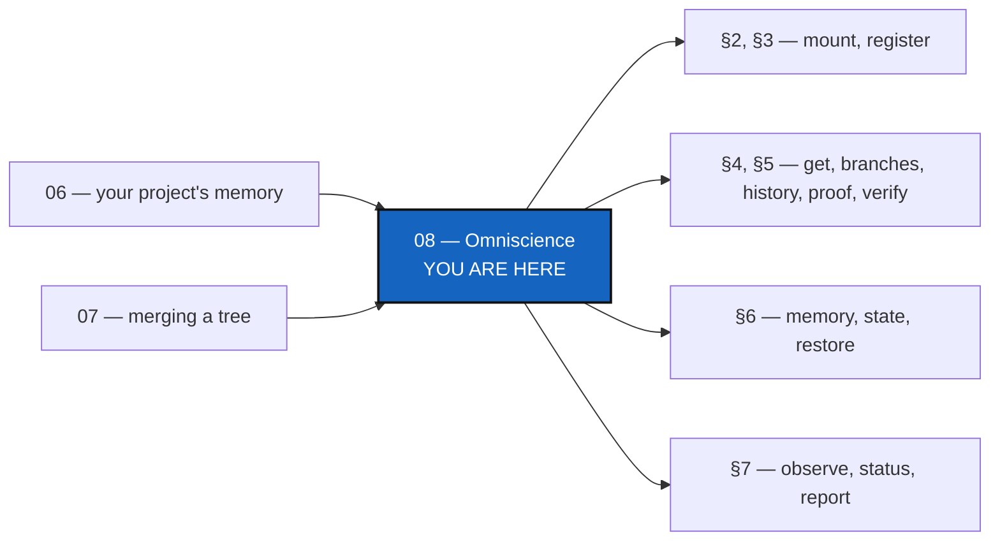

# Tutorial 8 of 8 — Omniscience: register your project's history, and ask for it from anywhere

*Created: 2026-10-21*

## Abstract — read this first

**What this document is.** How a developer registers a project's memory in
the shared register (Omniscience), and how anyone the register's provider
lets in finds a project by name, lists its branches and history, gets a State
with a checkable proof, reads the registered `.memory` at its exact commit,
asks whether the repositories are still there, and restores the project on
another machine.

**Why it exists.** A memory ([Tutorial 6](06_memory.md)) lives on one
developer's disk and in that developer's own remote. Omniscience is the one
place where the memories of many projects and many developers meet, without
being merged or copied. It is worth exactly what a reader can check, so this
tutorial teaches the checking as much as the asking.

**What you will find.** What it is (§1), joining and registering (§2, §3),
asking by name (§4), proofs (§5), reading the memory and restoring (§6),
whether things are still there (§7), the five answers (§8), a summary
table (§9), and how a gate, [GX4G](https://codeberg.org/gx4g/gx4g), holds
the register for readers who cannot mount it (§10).

**Who it is for.** A developer with a tree that has private repositories
([Tutorial 5](05_private_repos.md)) and a memory published to a remote
([Tutorial 6](06_memory.md)). Reading needs only access to the register.

**What you need to do with it.** Read §1 and §8 first. Work §2 and §3 once
per project, and §4 to §7 whenever you need to ask.



---

> **Every command below is a Pixi task.** Run `pixi install` once per
> checkout, then always call the CLI as `pixi run cgitsync ...`. The examples
> use a project called `MyProject`, and a State whose hash begins `3f9a`:
> `memory list` shows yours, and any unambiguous beginning of a hash will do.

## 1. What Omniscience is

One private repository, `omniscience`, shared by every registered project. It
holds, for each project branch, one small **record** per registration: which
State, which tree root, which ledger tip, and which `.memory` repository and
**commit** hold them. It holds no State, no source and no credential. On top
of the records sits one **checkpoint**, a Merkle root over every accepted
record of every project, and a new checkpoint names the one before it.

Three things follow, and the rest of this tutorial rests on them:

- **A record is a promise you can check.** The record names an exact commit of
  your `.memory`; a reader fetches that commit and tests it against the record.
- **Nothing is ever removed or rewritten.** A registration is added. A
  repository that vanishes later is noted *beside* the registration, never
  instead of it.
- **A proof is not an availability check.** "This State is registered" and "the
  repository holding it is still there" are two different questions with two
  different commands, and no answer ever confuses them.

Anyone the provider lets read the register can ask (§4 to §7). Only a
developer tree with push right can register (§3).

## 2. Join the register

On a developer's tree:

```bash
pixi run cgitsync omniscience mount --contribute
```

This adds the register to your `.cgs`, writable, and clones your project's
branch of it (or the index branch if your project has none yet) at
`.omniscience`. Leave out `--contribute` to mount it read-only, which is all a
reader needs. It registers nothing, and a user's tree (no private repository)
is refused by name: Omniscience is for developers.

## 3. Register a State

A record is built only from your **committed** memory, because a reader must be
able to fetch what it names. So fold your latest State into the memory and
push it first:

```bash
pixi run cgitsync memory push
pixi run cgitsync omniscience record 3f9a
pixi run cgitsync omniscience register --state 3f9a
```

`record` only prints what would be registered, with its hash (the record's file
name). `register` validates it, adds it to your project's branch of the
register, and extends the checkpoint. Without `--state` it takes the newest
State. Running it again does nothing twice: the same registration is the same
file.

Two developers may register at the same moment. The register never forces a
push: the one who loses the race is told, retries from the winner's tip, and
lands second. Nobody's record is lost.

## 4. Ask by name

```bash
pixi run cgitsync omniscience get MyProject
pixi run cgitsync omniscience branches MyProject
pixi run cgitsync omniscience history MyProject
pixi run cgitsync omniscience history MyProject --branch main
```

`get` says whether the project is registered, its `os_id` (the hash of its
name, the same on every machine), its branches and how many States. `branches`
gives each branch's newest State. `history` lists every registration, oldest
first, in the order the **checkpoints** accepted them. The time and the
contributor shown with each line are the contributor's own claims; the order is
the register's.

Every command takes `--json` for scripts, and `--checkpoint NAME` (any
unambiguous beginning of a checkpoint's name) to ask the register as it stood at
an earlier checkpoint. The earlier registrations keep verifying under the later
checkpoints; that is the point of the chain.

## 5. Check a State is registered

```bash
pixi run cgitsync omniscience proof MyProject 3f9a
pixi run cgitsync omniscience verify MyProject 3f9a
```

`proof` prints where the State's registration sits: its position among the
checkpoint's leaves, and the root. The tool checks the inclusion proof itself
and reports `proof_verified=True` only if it ends at the checkpoint's root and
size. It does not print the proof's path (the sibling hashes up to the root):
those are nodes of the Merkle tree, which `cgitsync` never shows (from 8.0.1).

`verify` does that, and also asks about the register itself:

| Register | What it means |
|---|---|
| `intact` | The chain is sound and this tree has seen nothing contradict it. |
| `attested` | Intact, and the index's tip commit carries a good signature. |
| `rewritten` | The remote's index no longer contains the tip this tree last found sound. History was rewritten there. **Reported, never repaired.** |
| `contradicted` | The register disagrees with itself: a forked or broken chain, a checkpoint naming a record that is gone, or a root that does not recompute. |

A tree that has never registered or observed has no earlier tip to compare, so
it cannot see `rewritten`; the answer says so (`last_seen_tip_known`). It also
lists the protections it checked: branch protection is "not checked", because
the host enforces it, not this tool.

## 6. Read the registered memory, and restore

```bash
pixi run cgitsync omniscience memory MyProject main
pixi run cgitsync omniscience state MyProject 3f9a
pixi run cgitsync omniscience state MyProject 3f9a --out restored.gts
```

`memory` clones the `.memory` the newest record of that branch names into a
temporary directory under `.cgitsync/`, reads the ledger and the State at the
registered commit, checks them against the record, and removes the clone. It
changes neither the memory nor the register. `state` does the same for one
State, adds its proof, and with `--out` writes its `.gts` to a file that does
not exist yet (it never overwrites). A reader without access to the private
`.memory` gets `unauthorized` and none of its content, only the registration
and proof, which are public.

To **restore on another machine**, take that file to the new machine and
install from it, as in [Tutorial 1](01_first_multi_repo_workspace.md):

```bash
pixi run cgitsync bootstrap restored.gts --force-protocol https
```

The new workspace has the same project name, so the same `os_id`, and the
earlier registrations keep verifying. A State registered from it later is
added to the same project's history.

If the memory has been tampered with, `memory` and `state` say `invalid`, name
what failed (`invalid_proof` for the State, `ledger_corrupt` for the ledger),
and, when the State can be read, name the repository whose own hash no longer
holds. When it cannot, they say the diagnosis is unavailable instead of
guessing.

## 7. Is it still there?

Registration is history. Whether a repository is still *there* today is
observed separately, and only when you ask:

```bash
pixi run cgitsync omniscience observe
pixi run cgitsync omniscience status MyProject memory
pixi run cgitsync omniscience report MyProject
```

`observe` asks the host about each registered repository and the memory, and
adds one observation per finding beside the records. It removes and rewrites
nothing. `status` shows one repository (`memory` for the project's `.memory`,
or a repository identifier as the record names it): its registration, which
still verifies, and the newest observation. Only an observation that found the
repository available gives `verified`; one never observed, or found missing,
closed, denied or unreachable, gives `unavailable`, with what was seen. A host
that says "not found" is a **warning**, because a private repository can answer
that to a reader it will not serve. It becomes a permanent failure only after
at least two findings over seven days, and nobody's deletion is believed
without the owner's signed note (`observe --confirm-deleted REPOSITORY
--reason TEXT`).

`report` puts it together: the register's state, whether every record of the
project is accepted and proved, any file that was only **proposed** (added by
hand and not accepted, with the reason), and completeness.

## 8. The five answers

Every query starts with `status=` and exits 0 only for `verified`.

| Answer | It means | Never means |
|---|---|---|
| `verified` | The registration holds: its proof ends at a sound checkpoint, or the memory read matches the record. | That any repository is available. |
| `invalid` | Something that should hold does not: a proof, a checkpoint, a ledger, a State, a rewritten register. The reason says what. | That anything was repaired. |
| `unavailable` | The honest "cannot tell": a remote that did not answer, a commit nobody serves, nothing observed yet. | That something was deleted. |
| `unauthorized` | The provider would not serve the reader. Nothing of the refused thing is shown. | That the thing does not exist. |
| `not_registered` | No such project, State, branch, checkpoint or repository in the register. A hand-added file that no checkpoint accepts counts as proposed, not registered. | |

When a memory could not be read, the `detail` says why: `remote_unavailable`,
`commit_unreachable` (the ref no longer leads to the registered commit),
`invalid_proof` or `ledger_corrupt`.

## 9. Summary

| To … | Command |
|---|---|
| Join the register | `omniscience mount [--contribute]` |
| See what would be registered | `omniscience record STATE` |
| Register a State | `omniscience register [--state STATE]` |
| Is the project registered? | `omniscience get PROJECT` |
| Its branches / its history | `omniscience branches PROJECT` / `history PROJECT [--branch B]` |
| Prove a State is registered | `omniscience proof PROJECT STATE` |
| Prove it, and judge the register | `omniscience verify PROJECT STATE` |
| Read the registered memory | `omniscience memory PROJECT BRANCH` |
| Get a State, or write its `.gts` | `omniscience state PROJECT STATE [--out FILE]` |
| Check what is still there | `omniscience observe`, then `status PROJECT REPOSITORY` |
| Everything about one project | `omniscience report PROJECT` |
| Ask as the register stood | add `--checkpoint NAME` |
| Script it | add `--json` |

Everything in §4 to §7 only reads. The only commands that write to the register
are `register` and `observe`, and they only add: no command rewrites, removes,
forces or repairs anything in it. The full reference is in
[docs/MASTER.pdf](../docs/MASTER.pdf).

## 10. Behind a gate: GX4G

Two rules above leave a gap. `mount` is refused on a user's tree (§2), and
every query in §4 to §7 reads the mount's own Git objects. So a user, or
anyone outside the project, cannot ask the register through `cgitsync` at
all, even though a registration and its proof are public (§6).

[GX4G](https://codeberg.org/gx4g/gx4g) fills that gap. It is the gate of a
ComplexGitSync Operating Space, and it uses the register rather than
replacing it. There is still one register, and these commands remain its
mechanism. In a GX4G Operating Space, the gate mounts the register itself.
Its developer spec declares it at the tree's root, beside `.cgitsync`:

```toml
{ repository = "github:flipoyo/omniscience", relative_path = ".omniscience", default_branch = "gx4g", fallback_branch = "main", private = true, writable = true, nested_config = "disabled" },
```

It is the entry `mount --contribute` would write (§2). Being private and
writable (private/local), `register` (§3) appends to it by the ordinary
mechanism, and every query reads it. The gate then answers for the
register. A user gets the registration and its proof (`proof`, `verify`),
and a developer the `.gts` (`state --out`) to `bootstrap` from. Neither
ever needs a mount of their own. Changing `repository` in that entry lets
a project use another register. The gate adds no command to `cgitsync`
and changes none of the answers in §8.

What the gate adds is outside this tool: which ring a request reaches,
and who may read or push each repository on its host. That is in GX4G's
[README](https://codeberg.org/gx4g/gx4g/src/branch/main/README.md) and
its tutorial
[05 — Omniscience behind GX4G](https://codeberg.org/gx4g/gx4g/src/branch/main/tutorials/05_omniscience.md).
